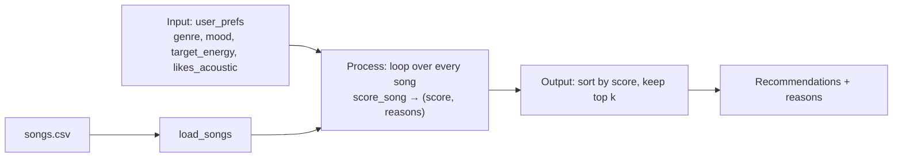

# 🎵 Music Recommender Simulation

## Project Summary

In this project you will build and explain a small music recommender system.

Your goal is to:

- Represent songs and a user "taste profile" as data
- Design a scoring rule that turns that data into recommendations
- Evaluate what your system gets right and wrong
- Reflect on how this mirrors real world AI recommenders

Replace this paragraph with your own summary of what your version does.

---

## How The System Works

Real-world recommenders like Spotify or YouTube combine two big ideas. **Collaborative filtering** says "people who liked what you liked also liked this," learned from millions of users' plays, skips and saves. **Content-based filtering** says "this song sounds like the songs you already like," using attributes of the item itself (audio features, genre tags, lyrics). At scale they mix both, re-rank the results for freshness and variety, and keep learning from feedback. My version is a small **content-based** recommender: it has no other users to learn from, so it compares each song's attributes directly to one user's stated taste. It prioritizes **genre** first, then **mood**, then how close the song's **energy** is to what the user wants, with a small nudge for acoustic vs. produced sound.

### Features used

**`Song`**
- `genre` (categorical: pop, lofi, rock, ...)
- `mood` (categorical: happy, chill, intense, ...)
- `energy` (0.0–1.0)
- `acousticness` (0.0–1.0)
- Loaded but not scored: `tempo_bpm`, `valence`, `danceability`. In this catalog they move almost in lockstep with energy, so scoring them too would count the same "intensity" signal several times.
- Advanced attributes (Challenge 1): `popularity` (0–100), `release_decade`, `mood_tags` (detailed tags like "nostalgic" or "adrenaline"), `instrumentalness` (0.0–1.0) and `explicit`. These only affect the score when a profile sets the matching optional preference below.

**`UserProfile`**
- `favorite_genre`
- `favorite_mood`
- `target_energy` (0.0–1.0)
- `likes_acoustic` (True/False)
- Optional (Challenge 1): `desired_tags` (list), `favorite_decade`, `likes_popular` (True = popular picks, False = hidden gems), `wants_instrumental`, `allow_explicit`

### Dataset

`data/songs.csv` started with 10 songs across 7 genres. I added 8 more (ids 11–18) to cover genres and moods the starter file was missing: hip-hop/confident, classical/melancholic, metal/angry, reggae/uplifting, country/nostalgic, edm/euphoric, r&b/romantic and folk/sad. The catalog now has 18 songs, 15 genres and 14 moods. The starter file already had the extra numeric features `danceability` and `acousticness`.

### User profile

The taste profile in `src/main.py`:

```python
user_prefs = {
    "favorite_genre": "lofi",
    "favorite_mood": "chill",
    "target_energy": 0.40,
    "likes_acoustic": True,
}
```

**Critique: can it tell "intense rock" from "chill lofi"?** Yes. Scored with the recipe below, the chill lofi songs come out on top (Library Rain 4.85, Midnight Coding 4.82) and the loud, high-energy songs land at the bottom (Neon Pulse 0.70, Iron Verdict 0.66). Flipping the profile to rock/intense/0.90/not acoustic flips the order: Storm Runner is first at 4.93 and Winter Sonata is last at 0.49. Energy and acousticness do most of the separating, so the profile still works when genre and mood don't match.

The profile is narrow in other ways. It has one favorite genre and one favorite mood, and matching is exact text, so a listener who also likes ambient gets no genre credit for "Spacewalk Thoughts", and "indie pop" doesn't count as "pop". With only 3 lofi songs in the catalog, the top 3 are almost decided before scoring starts.

### Algorithm recipe

**Scoring rule (one song → one number):**

| Factor | Points |
|---|---|
| Genre matches `favorite_genre` | +2.0 |
| Mood matches `favorite_mood` | +1.0 |
| Energy closeness | +1.5 × (1 − \|song.energy − target_energy\|) |
| Acoustic fit | +0.5 × acousticness if `likes_acoustic`, else +0.5 × (1 − acousticness) |

The energy term rewards being *close* to the target, not just being high or low: an exact match earns the full 1.5, and the points shrink as the gap grows. Genre is worth more than mood because genre describes the overall sound of a song, while the same mood (like "chill") can show up in very different genres. The maximum score is 5.0.

**Ranking rule (all songs → top k):** score every song, sort by score from highest to lowest, and return the first `k` along with the reasons each one scored the way it did.

We need both rules. The scoring rule only judges one song in isolation; it can't decide what to show. The ranking rule turns those separate scores into an ordered list and picks the top `k`. This is also where list-level decisions live (how many to show, how to break ties, whether to avoid five songs by the same artist), so you can change one rule without touching the other.

### Data flow



### Expected biases

- **Genre dominates.** A genre match (+2.0) is worth more than a mood match and acoustic fit combined. A great chill song in another genre can lose to a so-so song in the right genre.
- **Exact labels only.** "indie pop" and "pop" are unrelated strings to the scorer, and so are similar moods like "chill" and "relaxed".
- **Catalog imbalance.** Genres with more songs (lofi has 3 and pop has 2, while most others have 1) can fill the whole top k. Fans of single-song genres get one good match and then filler.
- **Energy is double-counted.** Acousticness tends to fall as energy rises, so the acoustic term mostly repeats the energy signal and pushes the results further toward low-energy or high-energy extremes.
- **No variety control.** Ranking is purely by score, so the list can be the same artist or the same sound five times over.

---

## Getting Started

### Setup

1. Create a virtual environment (optional but recommended):

   ```bash
   python -m venv .venv
   source .venv/bin/activate      # Mac or Linux
   .venv\Scripts\activate         # Windows

2. Install dependencies

```bash
pip install -r requirements.txt
```

3. Run the app:

```bash
python -m src.main                       # genre-first mode (default)
python -m src.main --mode mood-first     # or: energy-focused
python -m src.main --diverse             # penalize repeat artists and genres
python -m src.main --mode energy-focused --diverse -k 3
```

### Running Tests

Run the starter tests with:

```bash
pytest
```

You can add more tests in `tests/test_recommender.py`.

---

## Sample Recommendation Output

Output of `python -m src.main` for the first two profiles (the full run prints all eight):

```text
$ python -m src.main
Loaded songs: 18
Mode: genre-first  |  Diversity penalty: off

Profile: Default pop/happy  (best possible score 5.00)
  genre=pop, mood=happy, energy=0.80, likes_acoustic=False
+---+------------------+--------------+-------+------------------------------------+
| # | Song             | Genre / Mood | Score | Reasons                            |
+===+==================+==============+=======+====================================+
| 1 | Sunrise City     | pop          | 4.88  | genre match (+2.0)                 |
|   | by Neon Echo     | / happy      |       | mood match (+1.0)                  |
|   |                  |              |       | energy 0.82 vs target 0.80 (+1.47) |
|   |                  |              |       | produced sound (+0.41)             |
+---+------------------+--------------+-------+------------------------------------+
| 2 | Gym Hero         | pop          | 3.78  | genre match (+2.0)                 |
|   | by Max Pulse     | / intense    |       | energy 0.93 vs target 0.80 (+1.30) |
|   |                  |              |       | produced sound (+0.47)             |
+---+------------------+--------------+-------+------------------------------------+
| 3 | Rooftop Lights   | indie pop    | 2.77  | mood match (+1.0)                  |
|   | by Indigo Parade | / happy      |       | energy 0.76 vs target 0.80 (+1.44) |
|   |                  |              |       | produced sound (+0.33)             |
+---+------------------+--------------+-------+------------------------------------+
| 4 | Concrete Crown   | hip-hop      | 1.91  | energy 0.78 vs target 0.80 (+1.47) |
|   | by Block Theory  | / confident  |       | produced sound (+0.44)             |
+---+------------------+--------------+-------+------------------------------------+
| 5 | Night Drive Loop | synthwave    | 1.81  | energy 0.75 vs target 0.80 (+1.42) |
|   | by Neon Echo     | / moody      |       | produced sound (+0.39)             |
+---+------------------+--------------+-------+------------------------------------+

Profile: Lofi study  (best possible score 5.00)
  genre=lofi, mood=chill, energy=0.40, likes_acoustic=True
+---+---------------------+--------------+-------+------------------------------------+
| # | Song                | Genre / Mood | Score | Reasons                            |
+===+=====================+==============+=======+====================================+
| 1 | Library Rain        | lofi         | 4.85  | genre match (+2.0)                 |
|   | by Paper Lanterns   | / chill      |       | mood match (+1.0)                  |
|   |                     |              |       | energy 0.35 vs target 0.40 (+1.42) |
|   |                     |              |       | acoustic sound (+0.43)             |
+---+---------------------+--------------+-------+------------------------------------+
| 2 | Midnight Coding     | lofi         | 4.82  | genre match (+2.0)                 |
|   | by LoRoom           | / chill      |       | mood match (+1.0)                  |
|   |                     |              |       | energy 0.42 vs target 0.40 (+1.47) |
|   |                     |              |       | acoustic sound (+0.35)             |
+---+---------------------+--------------+-------+------------------------------------+
| 3 | Focus Flow          | lofi         | 3.89  | genre match (+2.0)                 |
|   | by LoRoom           | / focused    |       | energy 0.40 vs target 0.40 (+1.50) |
|   |                     |              |       | acoustic sound (+0.39)             |
+---+---------------------+--------------+-------+------------------------------------+
| 4 | Spacewalk Thoughts  | ambient      | 2.78  | mood match (+1.0)                  |
|   | by Orbit Bloom      | / chill      |       | energy 0.28 vs target 0.40 (+1.32) |
|   |                     |              |       | acoustic sound (+0.46)             |
+---+---------------------+--------------+-------+------------------------------------+
| 5 | Coffee Shop Stories | jazz         | 1.90  | energy 0.37 vs target 0.40 (+1.46) |
|   | by Slow Stereo      | / relaxed    |       | acoustic sound (+0.45)             |
+---+---------------------+--------------+-------+------------------------------------+
```

With the diversity penalty on, the second Neon Echo song drops out of the pop list and a rock song takes its place:

```text
$ python -m src.main --diverse
Profile: Default pop/happy  (best possible score 5.00)
  genre=pop, mood=happy, energy=0.80, likes_acoustic=False
+---+------------------+--------------+-------+------------------------------------+
| # | Song             | Genre / Mood | Score | Reasons                            |
+===+==================+==============+=======+====================================+
| 1 | Sunrise City     | pop          | 4.88  | genre match (+2.0)                 |
|   | by Neon Echo     | / happy      |       | mood match (+1.0)                  |
|   |                  |              |       | energy 0.82 vs target 0.80 (+1.47) |
|   |                  |              |       | produced sound (+0.41)             |
+---+------------------+--------------+-------+------------------------------------+
| 2 | Gym Hero         | pop          | 3.28  | genre match (+2.0)                 |
|   | by Max Pulse     | / intense    |       | energy 0.93 vs target 0.80 (+1.30) |
|   |                  |              |       | produced sound (+0.47)             |
|   |                  |              |       | genre already listed (-0.50)       |
+---+------------------+--------------+-------+------------------------------------+
| 3 | Rooftop Lights   | indie pop    | 2.77  | mood match (+1.0)                  |
|   | by Indigo Parade | / happy      |       | energy 0.76 vs target 0.80 (+1.44) |
|   |                  |              |       | produced sound (+0.33)             |
+---+------------------+--------------+-------+------------------------------------+
| 4 | Concrete Crown   | hip-hop      | 1.91  | energy 0.78 vs target 0.80 (+1.47) |
|   | by Block Theory  | / confident  |       | produced sound (+0.44)             |
+---+------------------+--------------+-------+------------------------------------+
| 5 | Storm Runner     | rock         | 1.78  | energy 0.91 vs target 0.80 (+1.33) |
|   | by Voltline      | / intense    |       | produced sound (+0.45)             |
+---+------------------+--------------+-------+------------------------------------+
```

**Screenshot or video** *(optional)*: <!-- Insert a screenshot or demo video link here -->

---

## Experiments You Tried

- **Six profiles.** `src/main.py` runs three normal listeners (pop/happy, lofi study, deep intense rock) and three edge cases (sad but high energy, a genre missing from the catalog, capitalized labels). The normal ones look right. The edge cases show that genre and mood labels outweigh energy, and that "Pop" doesn't match "pop".
- **Weight shift (genre 2.0 → 1.0, energy 1.5 → 3.0).** The rankings got different rather than clearly better. "Rooftop Lights" moved above "Gym Hero" for pop/happy, which is an improvement, but the sad-but-energetic user just traded a quiet sad song for loud intense ones.

- **Stretch features.**
  - **Advanced attributes:** five new song attributes, used by two new profiles. "Clean workout" showed that a −1.0 explicit penalty isn't enough to push "Gym Hero" out of first place.
  - **Scoring modes:** genre-first, mood-first and energy-focused.
  - **Diversity penalty:** repeat artists and genres lose points.
  - **ASCII table:** the terminal output now shows each song's reasons in a table.

  Details are in [ai_interactions.md](ai_interactions.md).

Full outputs, pair-by-pair comparisons and the experiment table are in the Evaluation section of [model_card.md](model_card.md).

---

## Limitations and Risks

Summarize some limitations of your recommender.

Examples:

- It only works on a tiny catalog
- It does not understand lyrics or language
- It might over favor one genre or mood

You will go deeper on this in your model card.

---

## Reflection

Read and complete `model_card.md`:

[**Model Card**](model_card.md)

Write 1 to 2 paragraphs here about what you learned:

- about how recommenders turn data into predictions
- about where bias or unfairness could show up in systems like this


